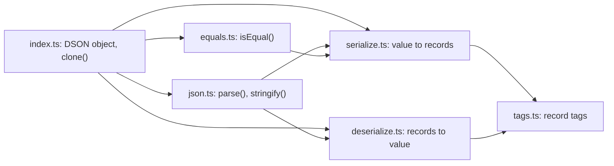

# Architecture

defuss-dson is one dependency-free module that turns a JavaScript value graph into JSON text and back. This page maps its modules for contributors and explains why each one is shaped the way it is. The wire format itself is specified in [documentation/format.md](documentation/format.md).

## Modules

| Module | Responsibility |
| --- | --- |
| `src/tags.ts` | The numeric record tags and the record type. The numbers are wire format and never change. |
| `src/serialize.ts` | Walks a value once and writes `[tag, payload]` records; record 0 is the root. Pure, no I/O. |
| `src/deserialize.ts` | Rebuilds a value from records, from fixed constructor lists only. Pure, no I/O. |
| `src/json.ts` | `parse` and `stringify`: the record list carried by `JSON.parse` and `JSON.stringify`. |
| `src/equals.ts` | `isEqual`: compares two values by their DSON text. |
| `src/index.ts` | The public `DSON` object and `clone`; its interface carries the API documentation into the published type declarations. |

## Why this design

**A flat record list instead of a nested tree.** A nested encoding needs a second mechanism for cycles and shared references, such as path pointers, and must copy a shared value each time it appears. With records, every value gets an index the first time the encoder meets it, and later references are that index. The same index map that stops the walk at a cycle also deduplicates repeated strings. The decoder registers each container before decoding its members, so a member that refers back finds the container under construction.

**JSON as the carrier instead of a binary format.** DSON text is valid JSON, so it fits wherever JSON already goes (HTTP bodies, `localStorage`, `postMessage`, databases, log lines), any JSON parser reads it, and a developer can read it in a debugger. A binary format would be smaller, but it would need its own transport handling and tooling everywhere it travels.

**Fixed constructor lists in the decoder instead of an open global lookup.** The record tag is part of the input. Resolving any tag with `globalThis[tag]`, as defuss-dson did up to 1.1.2, let a crafted payload construct any global, such as `Function` or `WebSocket`. The decoder therefore builds the structural tags directly and accepts string tags only from the list of typed arrays, binary types and wrapper objects the encoder writes; anything else throws. Typed arrays are still fetched from `globalThis` after the list check, so that a runtime without `Float16Array` fails with a clear error instead of at module load.

**`isEqual` by encoding instead of a graph walk.** Comparing two cyclic graphs structurally needs a visited-pair map and careful handling of shared references. The encoder already resolves both into indices, so comparing two DSON texts is one linear pass whose rules are exactly what `stringify` preserves. The cost is that order counts (object keys, Map and Set entries); the README states that. VERIFIED: on the bench graph (2,000 objects with Maps, Sets, Dates and typed arrays), three interleaved `make bench` runs on Node.js 26 (2026-11-01) gave medians of 26.9 to 35.3 ms for 1.1.2 and 11.9 to 15.8 ms for 1.2.0, 1.7 to 2.8 times faster per pair; the absolute times follow the machine's load. 1.1.2 compared stringify-parse-stringify round trips.

**An explicit stack instead of recursion.** A recursive walk is the shortest code, but its depth limit is the engine's call stack, which differs by runtime and is far below what `JSON` handles. The encoder therefore keeps the path of open containers in an array of frames and writes one member per turn, innermost container first; the records come out in the same depth-first order as before, so the text is unchanged. The decoder creates each container empty, registers it and queues it, then fills the queue; members attach by reference, so the order of filling does not matter. Because the walk no longer stops on its own when a getter produces a new object on every read, `stringify` throws a `RangeError` past `maxDepth` levels, 100,000 unless the caller passes another value, as `JSON.stringify` throws at its stack limit. Why an option and not a fixed number: deep data such as long linked lists is legitimate, and only the caller knows how deep its own data goes. VERIFIED: the recursive walk overflowed at 2,343 levels on Node.js 26 and 18,779 on Bun 1.4.3, where `JSON` round-tripped more than 200,000 and 40,000; `src/structure.test.ts` round-trips 50,000. VERIFIED: three interleaved `make bench` runs per build (2026-11-01) showed the stack-based build within the run-to-run spread of the recursive one.

**`structuredClone` first in `clone`.** It is native and keeps what text cannot (Error stacks, one buffer shared by several views). The DSON fallback serves runtimes without it, and runs in strict mode so that functions and symbols throw there too, matching `structuredClone`.

**Special numbers under their own tag (9), but as strings inside typed arrays.** Plain `NaN`, `±Infinity` and `-0` need a tag, because a primitive record cannot distinguish the string `"NaN"` from the number. Inside a typed array the constructor converts strings to numbers itself, so no tag is needed, and readers older than 1.2.0 decode those arrays correctly.

## How it works

`stringify` calls `serialize(value, json = true)`, which matches `JSON.stringify` for functions, symbols and `toJSON()`, and passes the record list to `JSON.stringify`. `parse` calls `JSON.parse` and hands the records to `deserialize`. `isEqual` serializes with `signedZero = false`, so that `0` and `-0` compare equal like `===`, and compares the texts. `clone` uses `structuredClone`, or `deserialize(serialize(value))` in strict mode.

The encoder classifies a value by its internal brand (`Object.prototype.toString`), which survives subclassing and realms where `instanceof` fails, and by `ArrayBuffer.isView` for typed arrays and `DataView`. Class instances and unknown objects become plain objects of their own enumerable string keys.

## Operations

- **Configuration:** no global settings. `stringify` and `isEqual` take `{ maxDepth }` per call (default 100,000).
- **Build:** `pkgroll` writes unminified ESM, CommonJS and declaration files into `dist/` (`make build`). The package ships only `dist/`, `README.md` and `LICENSE`; e2e checks the tarball contents.
- **Website:** `docs/` is served by GitHub Pages at <https://dson.defuss.org> (`docs/CNAME`). It runs the copy of the build in `docs/assets/lib/` and a Shiki bundle built from `scripts/shiki-entry.mjs`: four grammars (JavaScript, HTML, JSON, shell), the GitHub light and dark themes and the JavaScript regex engine, so no WebAssembly and no third-party script at runtime. `make docs` regenerates both files, `docs/data/manifest.json`, the page figures and the README size table, and e2e fails while they differ from the build.
- **Benchmarks:** `make bench` runs the benchmark of `scripts/bench-core.mjs` on Node.js and Bun (`scripts/bench.mjs`) and in Chromium and WebKit pages (`scripts/bench-browser.mjs`, Playwright): the median of 20 samples per operation, each sample long enough for the browsers' coarse timers, and the peak RSS of a fresh process per operation. Node.js and Bun report their own high-water mark; in the browsers a page cannot read its process's memory, so the runner samples the page's process with `ps` while the operation runs, and leaves the figure empty when it cannot tell which process that is. Results go to `output/bench/`; `make docs` publishes them to `docs/data/bench.json` when they measured the current `dist/index.mjs` (SHA-256), and e2e fails when the published figures measured another build. The coverage figures on the website come from `make coverage` through `docs/data/coverage.json`.
- **Verification:** `make verify` runs lint, the Vitest unit suite on Node.js and Bun, coverage, and e2e on the packed tarball (Vitest on Node.js and Bun, Playwright in Chromium and WebKit). CI runs the same target (`.github/workflows/verify.yml`).
- **Compatibility:** `engines` declares Node.js 18.17 or newer. The suites run on the Node.js of the machine (CI pins 24), Bun, Chromium and WebKit; older runtimes are not tested. `structuredClone` is optional. The wire-format compatibility rules are in [documentation/format.md](documentation/format.md#compatibility).

## Security and privacy

The trust boundary is `DSON.parse`: its input may come from another process or user. It looks a tag up on the global object only after the tag matched the fixed list of typed arrays, it refuses every other tag, it builds binary data only from lists in the text, and it defines a key that converts to `__proto__` as an own property instead of setting the prototype. Its work and memory grow with the length of the text, at any nesting depth, and every failure after `JSON.parse` is a `TypeError`. VERIFIED: `src/untrusted.test.ts` parses 3,000 seeded mutations of valid record lists, and each one returns data without a buffer larger than eight bytes per character of text or a replaced prototype, or throws a DSON `TypeError`. Remaining risks belong to the caller: there is no size limit on the text, and decoded values such as a `RegExp` are the sender's data.

The encoder writes an Error's `name` and `message` but not its stack, because a stack trace exposes the sender's file paths. The library performs no I/O, opens no connections, and collects no data. The website runs the visitor's playground code in the visitor's own tab and loads defuss-shadcn from jsDelivr with Subresource Integrity hashes. It also asks jsDelivr's API for the version npm marks as latest, for the version badges; that request carries no data about the visitor beyond what any request to jsDelivr does, and the page keeps the build's version when it fails.
